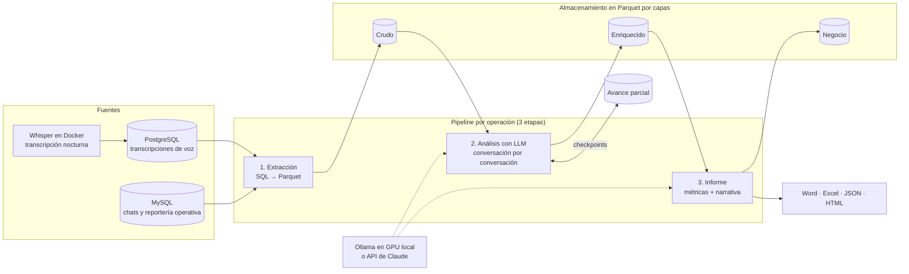

# Auditoría de calidad de llamadas y chats con IA

Plataforma de analítica que toma las conversaciones de un contact center (llamadas transcritas con Whisper y chats de WhatsApp), las audita **una por una con un modelo de lenguaje** según una matriz de calidad y produce el informe mensual de gestión para la gerencia de cada cliente: Word, Excel, JSON y tableros HTML.

> [!IMPORTANT]
> Este repositorio es una **exhibición técnica**. El sistema real es propiedad de la empresa para la que lo construí y no se publica.
> Aquí no hay código, datos, nombres ni configuraciones de esa empresa: hay diagramas, decisiones de diseño y un **ejemplo ejecutable escrito desde cero con datos sintéticos**. Ver [AVISO.md](AVISO.md).

## En 30 segundos

| Pregunta | Respuesta |
|---|---|
| ¿Qué problema resuelve? | Revisar a mano una muestra de llamadas es lento y sesgado. El sistema audita el **100 %** de las conversaciones del mes con criterios homogéneos. |
| ¿Cuánto procesa? | Desde cientos hasta miles de conversaciones por operación y por mes, en más de diez operaciones. |
| ¿Dónde corre la IA? | En un **servidor propio con GPU** (Ollama, modelos abiertos). Hay una ruta opcional a la API de Claude para comparar calidad. |
| ¿Qué hace la IA y qué no? | La IA **lee y califica** cada conversación y **redacta** la narrativa. Las cifras del informe las calcula **pandas de forma determinista**. |
| ¿Cómo se guardan los datos? | En **Parquet**, organizados en capas: datos crudos, datos enriquecidos por la IA y datos listos para el negocio. |
| ¿Cómo se construyó? | Con un **flujo de desarrollo multiagente** (Claude Code con orquestador, subagentes, memoria persistente y revisión independiente) dirigido y verificado por mí. |

## Arquitectura general



## Stack

| Capa | Herramientas |
|---|---|
| Lenguaje y entorno | Python 3.12, `uv`, `tmux`, `cron`, `systemd`, Docker |
| Datos | pandas, PyArrow / Parquet, SQL (PostgreSQL, MySQL), SQLAlchemy, DuckDB (en el ejemplo) |
| IA | Ollama (Llama 3, Qwen, Gemma, Ministral), embeddings `nomic-embed-text`, API de Claude, LangChain, Pydantic v2 |
| Voz | Whisper (faster-whisper / CTranslate2) |
| Entregables | python-docx, openpyxl, HTML con Chart.js |
| Desarrollo asistido | Claude Code, subagentes, MCP, memoria persistente (Engram), flujo ODD |

## Documentación

Léela en orden o salta a lo que te interese:

| # | Documento | Qué vas a encontrar |
|---|---|---|
| 1 | [Arquitectura](docs/01-arquitectura.md) | Las 3 etapas, el módulo compartido y las decisiones que las sostienen |
| 2 | [Datos y almacenamiento](docs/02-datos-y-almacenamiento.md) | Flujo de datos, capas, Parquet, consultas SQL y cómo evolucionaría hacia Delta Lake y un warehouse |
| 3 | [La IA dentro del pipeline](docs/03-ia-en-el-pipeline.md) | Salidas estructuradas, checkpoints, embeddings, comparación de modelos y LLM como juez |
| 4 | [Desarrollo con sistemas multiagente](docs/04-desarrollo-multiagente.md) | Cómo usé un orquestador con subagentes, memoria y revisión independiente para construir el sistema |
| 5 | [Despliegue y operación](docs/05-despliegue-y-operacion.md) | Servidor con GPU, presupuesto de VRAM, ventanas de cron y flujo de git |
| 6 | [Lecciones aprendidas](docs/06-lecciones-aprendidas.md) | Los errores reales que encontramos y la regla que dejó cada uno |

## Probar el ejemplo

El ejemplo reproduce el patrón de las 3 etapas con conversaciones **inventadas** y un analizador simulado, así que no necesita GPU ni bases de datos.

```bash
cd ejemplo
uv run generar_datos.py      # crea conversaciones sintéticas (capa cruda)
uv run pipeline.py           # etapas 2 y 3: análisis simulado + métricas
uv run consultas.py          # consultas SQL con DuckDB sobre los Parquet
```

Detalles en [ejemplo/README.md](ejemplo/README.md).

## Mi rol

Diseñé la arquitectura, definí las reglas de datos y de calidad con las áreas de negocio, operé el servidor y presenté los resultados a la gerencia de los clientes. Los asistentes de IA escribieron buena parte del código **bajo mi dirección**: yo fijé el alcance, revisé cada cambio y validé cada cifra antes de que llegara a un cliente.
