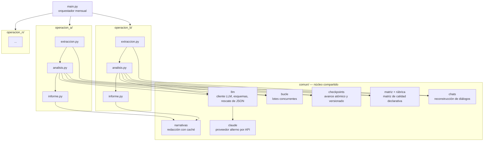
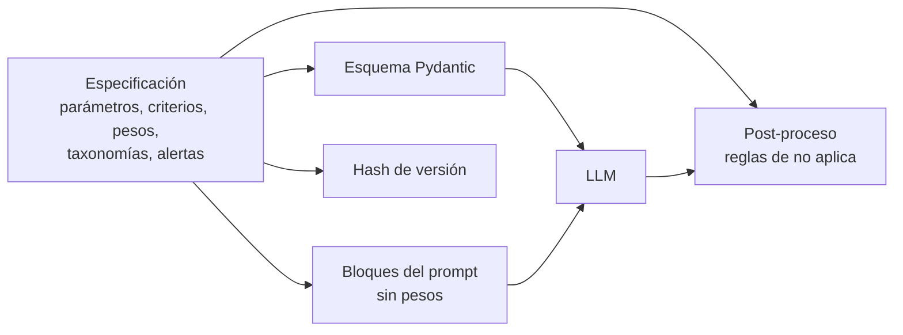

# 1. Arquitectura

**Cada operación es un pipeline de 3 etapas independientes que solo se comunican mediante archivos Parquet.** Toda la lógica compartida vive en un único módulo común, y un orquestador ejecuta las operaciones del mes en orden.

## Vista de componentes

## Las 3 etapas

| Etapa | Entrada | Trabajo | Salida | Duración típica |
|---|---|---|---|---|
| **1. Extracción** | PostgreSQL y MySQL | SQL, reconstrucción de chats como diálogo, unión de voz y chat, muestreo estadístico, embudo de filtros | Parquet de la capa cruda | Minutos |
| **2. Análisis** | Parquet de la etapa 1 | El LLM califica cada conversación con salida JSON validada | Parquet de la capa enriquecida | De minutos a ~10 h (GPU) |
| **3. Informe** | Parquet de la etapa 2 | Métricas en pandas, narrativa con el LLM, armado de documentos | Word, Excel, JSON y HTML | Minutos |

### Por qué 3 etapas desacopladas

- **La etapa cara se aísla.** El análisis consume horas de GPU. Si el informe cambia, no se vuelve a analizar nada.
- **Cada frontera se puede inspeccionar.** Un Parquet intermedio se abre, se consulta y se audita. Es el contrato entre etapas.
- **Se reanuda donde falló.** Ninguna etapa llama a la anterior: cada una lee el archivo que dejó la previa.
- **Es fácil de explicar.** Una carpeta por operación con exactamente 3 archivos. Lo que sirve a varias operaciones va a `comun/`.

## El núcleo compartido

Al principio, cada operación era una copia adaptada de otra. Una corrección en una no se propagaba a las demás. La consolidación en `comun/` resolvió eso:

| Módulo | Responsabilidad | Decisión clave |
|---|---|---|
| `llm` | Crear el cliente del modelo y procesar respuestas | Le pasa el **JSON Schema de Pydantic** al modelo para que la salida quede restringida por gramática |
| `bucle` | Procesar filas en lotes con concurrencia | Devuelve los resultados **en el orden de entrada** y guarda avance periódicamente |
| `checkpoints` | Guardar y recuperar avance parcial | Escritura **atómica** (`tmp` + `fsync` + `replace`) y **huella** de la entrada y de la versión del análisis |
| `narrativas` | Redactar textos del informe | Caché por hash del prompt; un fallo queda **marcado como error**, nunca se rellena con texto inventado |
| `matriz` + `rubrica` | Definir la matriz de calidad de forma declarativa | Una especificación genera el esquema, el prompt y el post-proceso determinista |
| `chats` | Convertir mensajes sueltos en diálogo `Agente:` / `Cliente:` | Orden estable de los mensajes para que la huella no cambie |
| `claude` | Proveedor alterno por API | Se conecta a las **mismas costuras** que el proveedor local, sin cambiar el bucle |

## Matriz de calidad declarativa

Las operaciones nuevas no escriben prompts a mano. Declaran sus parámetros y el módulo genera el resto:

Los **pesos no van en el prompt**: el modelo califica cada parámetro de 1 a 10, y la ponderación se calcula después en pandas. Así el modelo no "negocia" con los pesos, y estos se pueden ajustar sin volver a analizar nada.

La evidencia se maneja por **fragmentos numerados**. El modelo no copia citas: devuelve el número del fragmento que respalda cada calificación. El informe publica el texto de ese fragmento tomado de la transcripción, así que la cita es literal por construcción.

## Principios de diseño

| Principio | Cómo se aplica |
|---|---|
| La IA interpreta, el código cuenta | Ningún indicador sale del LLM. Promedios, rankings y alertas se calculan en pandas |
| Fallar en voz alta | Si falta el archivo de entrada, la etapa se detiene con un error. Nunca genera datos de relleno |
| Nada se descarta en silencio | Las filas que no se pueden analizar quedan **marcadas** (texto corto, contexto insuficiente, JSON rescatado) y no se borran |
| Reproducibilidad | La versión del análisis es un hash de prompt + esquema + modelo. Si cambia algo, el avance anterior se invalida solo |
| Humano al final | Toda salida del modelo la revisa un analista antes de llegar al cliente |

## Siguiente

[2. Datos y almacenamiento →](02-datos-y-almacenamiento.md)
