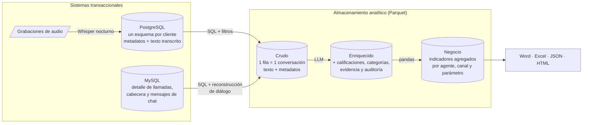
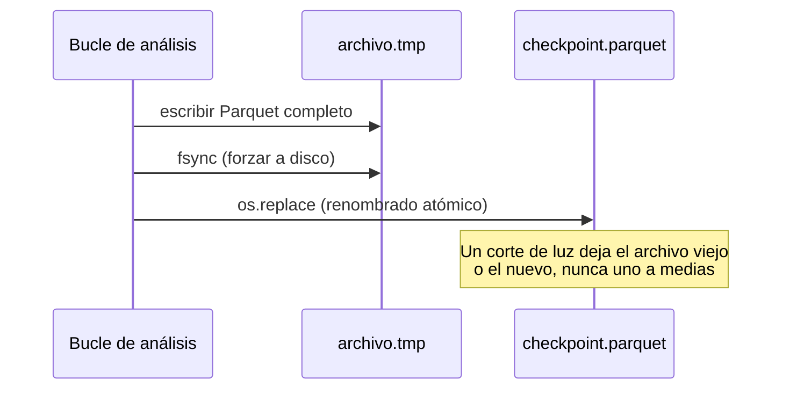
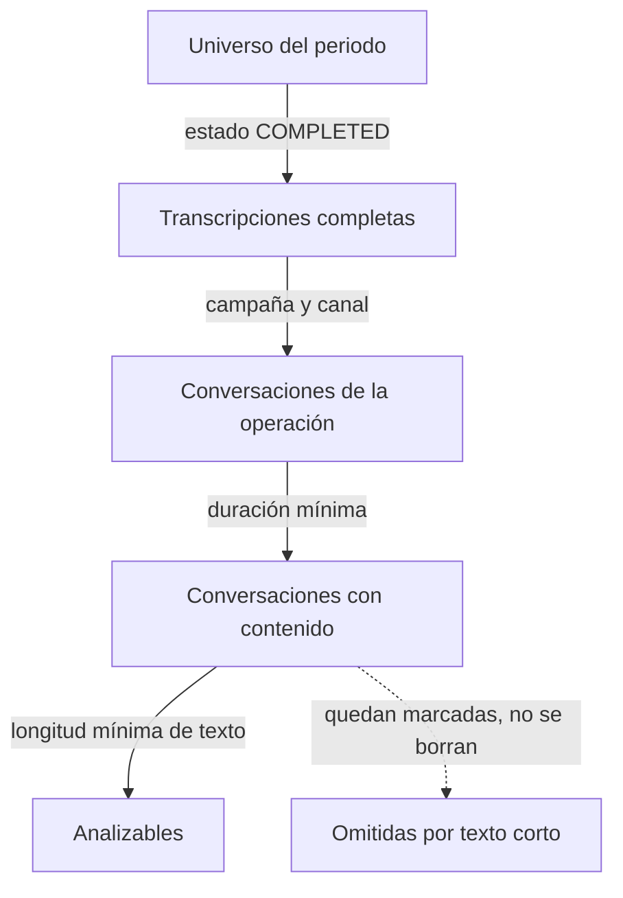
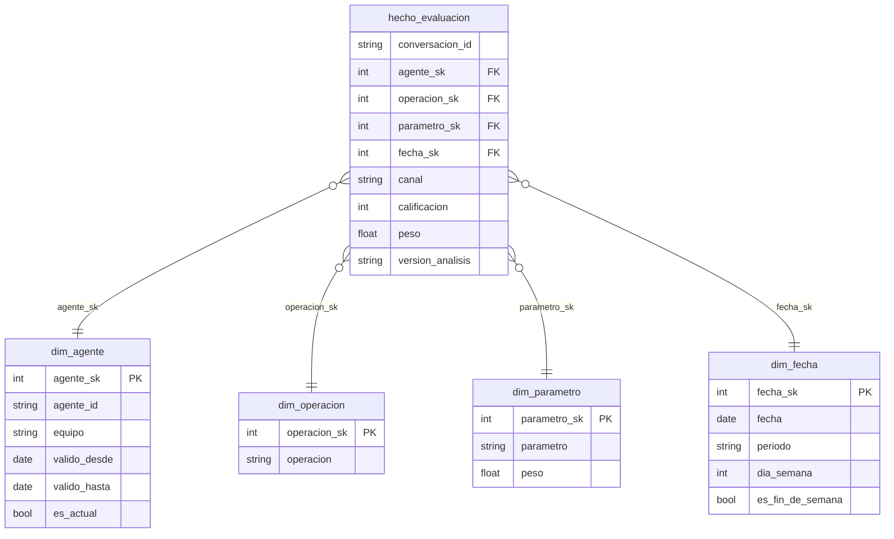

# 2. Datos y almacenamiento

**Los datos viajan de bases transaccionales a archivos Parquet organizados en tres capas: crudo, enriquecido y negocio.** Cada capa es inmutable para un periodo dado y es el contrato de entrada de la siguiente. Las consultas analíticas se hacen sobre esos archivos, no sobre las bases de producción.

## Flujo de datos de punta a punta



## Las capas

El diseño sigue el patrón por capas conocido como *medallion* (bronce, plata y oro), adaptado a archivos Parquet en disco:

| Capa | Equivale a | Grano | Qué agrega | Quién la consume |
|---|---|---|---|---|
| **Crudo** | Bronce | Una conversación | Texto unificado de voz y chat, metadatos operativos y tipificación del agente | Etapa de análisis |
| **Enriquecido** | Plata | Una conversación | Calificación por parámetro, categorías, número de fragmento de evidencia y columnas de auditoría del modelo | Etapa de informe y analistas |
| **Negocio** | Oro | Agregado | Promedios ponderados, rankings, distribución de motivos y alertas | Gerencia (Excel, JSON y HTML) |

Las columnas de auditoría de la capa enriquecida son las que hacen confiable el dato:

| Columna | Para qué sirve |
|---|---|
| `tokens_prompt` | Saber cuánto contexto usó realmente cada fila |
| `contexto_insuficiente` | Marcar filas que llenaron más del 90 % de la ventana del modelo |
| `json_rescatado` | Marcar respuestas truncadas que se recuperaron |
| `error_log` | Registrar errores reales, separados de la prosa del modelo |
| `version_analisis` | Hash de prompt + esquema + modelo: el linaje de cada resultado |

## Por qué Parquet

Las conversaciones pesan: cada fila trae miles de caracteres de texto y decenas de columnas de resultados.

| Necesidad | Lo que aporta Parquet |
|---|---|
| Leer pocas columnas de tablas anchas | Formato **columnar**: el informe lee las calificaciones sin cargar el texto completo |
| Ocupar poco disco | Compresión por columna (Snappy o Zstd) y codificación por diccionario para categorías repetidas |
| Respetar los tipos entre etapas | **Esquema embebido**: fechas, enteros nulos y booleanos llegan intactos a la siguiente etapa, cosa que CSV no garantiza |
| Filtrar sin leerlo todo | Estadísticas por *row group* que permiten **predicate pushdown** en motores como DuckDB, Spark o Polars |
| Portabilidad | El mismo archivo lo leen pandas, DuckDB, Spark, Power BI o un motor de warehouse |

### Escritura segura de checkpoints

El análisis tarda horas. El avance se vuelca a Parquet cada 5 % de las filas con escritura **atómica**:



Cada checkpoint guarda dos huellas:

- **Huella de entrada:** SHA-256 de los textos, sensible al orden y al número de filas. Si la extracción cambia, el checkpoint no se reutiliza.
- **Versión del análisis:** hash de prompt + esquema + modelo. Si cambia la forma de analizar, el avance viejo se descarta solo.

## Consultas

La extracción usa SQL sobre las bases transaccionales: `JOIN` entre metadatos y texto, filtros por estado, campaña, duración y fecha, y `ORDER BY` determinista, porque la huella depende del orden. Los chats se reconstruyen desde una tabla de mensajes (una fila por mensaje) agrupando por conversación y ordenando por marca de tiempo.

Sobre los Parquet, las preguntas de negocio se responden con SQL analítico. En el [ejemplo](../ejemplo/consultas.py) uso DuckDB, que consulta Parquet directamente:

```sql
-- Ranking de agentes por puntaje ponderado, por canal
WITH puntajes AS (
    SELECT agente_id, canal,
           AVG(puntaje_ponderado) AS promedio,
           COUNT(*)               AS conversaciones
    FROM read_parquet('datos/negocio/evaluaciones/**/*.parquet', hive_partitioning = true)
    WHERE periodo = '2026-10'          -- poda de particiones: solo lee esa carpeta
    GROUP BY agente_id, canal
)
SELECT *,
       RANK() OVER (PARTITION BY canal ORDER BY promedio DESC) AS posicion
FROM puntajes
WHERE conversaciones >= 5;
```

Patrones que uso en esas consultas: CTE, funciones de ventana (`RANK`, `LAG` para la variación entre meses), agregaciones condicionales, `QUALIFY` y lectura de particiones con comodines.

## Embudo de selección

Cada extracción documenta **cuántas filas se pierden en cada filtro**. Es el linaje a nivel de conteo, y responde la primera pregunta de la gerencia: "¿por qué se analizaron N y no M?".



## Cómo evolucionaría

Hoy las capas son archivos Parquet en el disco de un servidor, una solución proporcional al volumen actual. Si el volumen o el número de consumidores crece, el diseño está preparado para dar estos pasos:

| Paso | Qué cambia | Qué resuelve |
|---|---|---|
| **Particionado estilo Hive** (`operacion=…/periodo=…/`) | La ruta del archivo codifica las dimensiones | Lecturas selectivas por partición. El ejemplo de este repositorio ya lo usa |
| **Almacenamiento de objetos** (S3, ADLS, GCS o MinIO) | Las capas salen del disco local | Separación entre cómputo y almacenamiento, y acceso desde varias herramientas |
| **Delta Lake** sobre las mismas capas | Los Parquet quedan bajo un *transaction log* | Transacciones ACID, `MERGE` para reanudar análisis (reemplaza el checkpoint casero), *time travel* para comparar versiones de prompt, y validación y evolución de esquema |
| **Modelo dimensional para la capa de negocio** | Tabla de hechos `hecho_evaluacion` (una fila por conversación y parámetro) y dimensiones `agente`, `operacion`, `parametro` y `fecha` | Consultas de BI rápidas y consistentes en un warehouse. `agente` como dimensión lenta tipo 2 para conservar su historial de campañas. El ejemplo de este repositorio ya lo implementa |
| **Orquestación declarativa** (Airflow, Dagster o Prefect) | Las 3 etapas pasan a ser tareas con dependencias | Reintentos, alertas y linaje visibles, en reemplazo de `cron` + `tmux` |



### El modelo estrella en el ejemplo

La [etapa 3 del ejemplo](../ejemplo/pipeline.py) construye este modelo sobre la capa de negocio, en `datos/negocio/modelo/`:

- **Grano explícito:** una fila de `hecho_evaluacion` por conversación y parámetro de la matriz. El puntaje ponderado de una conversación es `SUM(calificacion * peso)`, y cuadra con el que calcula pandas.
- **`dim_agente` como SCD tipo 2:** se construye desde una bitácora de cambios de equipo con `LEAD()`. Cada versión tiene `valido_desde`, `valido_hasta` y `es_actual`, y vence el día antes de que empiece la siguiente.
- **Búsqueda de clave sustituta en el tiempo:** cada hecho toma la versión del agente vigente **el día de la conversación** (`fecha BETWEEN valido_desde AND valido_hasta`). Un hecho sin versión vigente detiene el pipeline: no se rellena.
- **`dim_fecha` como calendario completo** de los meses cubiertos, con clave inteligente `AAAAMMDD`, no solo los días que tienen datos.

Por qué importa el tipo 2: si el cambio de equipo sobrescribiera la fila del agente (tipo 1), las conversaciones anteriores al traslado quedarían atribuidas al equipo nuevo. La consulta `SCD2 frente a sobrescribir` de [`consultas.py`](../ejemplo/consultas.py) lo muestra con los datos sintéticos: un equipo creado a mitad de octubre recibe 37 conversaciones al sobrescribir, cuando solo atendió 14.

### Contratos de calidad entre capas en el ejemplo

Que una capa sea "el contrato de entrada de la siguiente" solo vale si el contrato se verifica. En el ejemplo, cada etapa calcula su salida en memoria, la audita con [`calidad.py`](../ejemplo/calidad.py) y **solo la escribe si pasa** (patrón *write-audit-publish*). Si alguna regla falla, la capa no se publica, la etapa se detiene y el reporte `datos/informes/calidad/<capa>_<periodo>.json` dice qué regla falló y en cuántas filas.

| Capa | Reglas |
|---|---|
| Crudo | Clave única y no nula, campos obligatorios, canal y fecha dentro de su dominio, **conciliación del embudo** (filas = voz seleccionada + chats, y lo seleccionado no supera el universo) y `analizable` coherente con el largo del texto |
| Enriquecido | Mismas conversaciones que la capa cruda, notas de 1 a 10, motivo dentro del catálogo, cita literal de la transcripción, omitidas sin notas y una sola versión de análisis |
| Negocio | Una evaluación por cada conversación analizable, pesos que suman 1 y puntaje dentro de la escala |
| Modelo estrella | Hechos sin agente vigente, grano sin duplicados y hechos = evaluaciones × parámetros |

El reporte se escribe también cuando todo pasa: queda constancia de qué se verificó en cada corrida. La validación con Pydantic protege cada respuesta del modelo; los contratos protegen la capa completa, incluidos los defectos que ninguna fila revela por sí sola, como una conversación perdida en un `JOIN` o un embudo que no cuadra.

## Siguiente

[3. La IA dentro del pipeline →](03-ia-en-el-pipeline.md)
