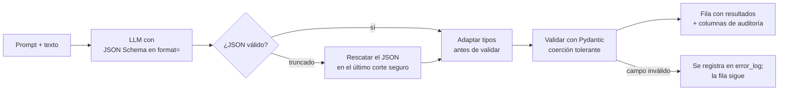
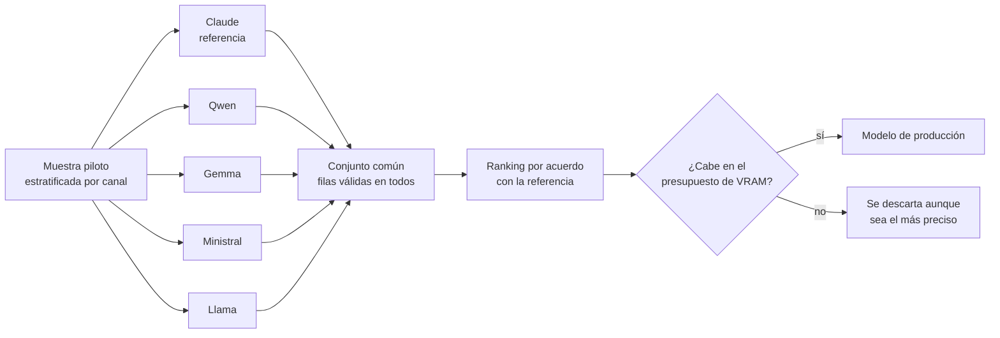
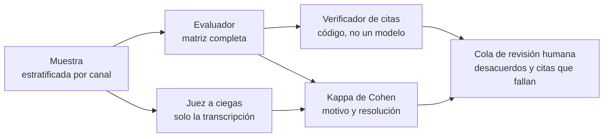

# 3. La IA dentro del pipeline

**El modelo de lenguaje es un componente más del pipeline, con entradas y salidas tipadas, versionado y auditable.** Lee y califica cada conversación y redacta la narrativa del informe. No calcula ningún indicador ni decide nada sin revisión humana.

## Dónde interviene la IA

| Punto | Modelo | Temperatura | Salida |
|---|---|---|---|
| Transcripción de voz | Whisper | — | Texto de la llamada |
| Calificación de cada conversación | LLM local (Ollama) o Claude | 0 | JSON validado con Pydantic |
| Emparejamiento de texto libre con una taxonomía | `nomic-embed-text` (embeddings) | — | Categoría o "propuesta nueva" |
| Consolidación de motivos abiertos | LLM | 0 | Entre 8 y 12 categorías con definición |
| Narrativa del informe | LLM | ~0,3–0,4 | Párrafos sobre métricas ya calculadas |

## Salidas estructuradas que no rompen el pipeline

Con miles de filas por corrida, el 1 % de respuestas mal formadas equivale a decenas de filas perdidas. La defensa tiene varias capas:

1. **Restricción por gramática.** El JSON Schema del modelo Pydantic se pasa en `format=`, y Ollama solo puede generar texto que lo cumpla. Todas las claves son obligatorias.
2. **Rescate.** Si la respuesta se corta, se recupera el JSON hasta el último punto seguro y la fila queda marcada.
3. **Adaptación.** Un campo mal tipado se corrige o se anula sin tirar la fila completa.
4. **Cadena de respaldo** sin esquema, para servidores con versiones antiguas de Ollama.

## Lo que aprendimos sobre clasificar con LLM

Se midió cada hipótesis contra una referencia humana. Ninguna regla salió de la intuición:

| Hallazgo | Regla resultante |
|---|---|
| El modelo genera los campos en el orden en que están declarados. Si la etiqueta va primero, decide antes de razonar | **Evidencia → resumen en texto libre → etiqueta**, en ese orden |
| Con las opciones solo en el JSON Schema, casi todo cayó en "Otro" | Las listas cortas (menos de ~25 opciones) van **impresas en el prompt, con una glosa** por opción |
| Con un ejemplo literal en el prompt, más de la mitad de las respuestas lo copiaron | **Sin ejemplos literales** |
| Reordenar las opciones "por significado" casi duplicó la distancia a la referencia humana | El modelo es sensible a la posición. Se mantiene el **orden por frecuencia** |
| Una categoría con más del 90 % de las filas resultó ser un colapso del modelo, no un hallazgo | Una categoría dominante es **sospechosa**. El informe alerta si alguna pasa del 40 % |
| Emparejar texto libre por coincidencia de palabras daba falsos positivos | **Embeddings + similitud coseno** con umbral, restringidos al subconjunto pertinente (p. ej., los submotivos del motivo elegido) |

## Ventana de contexto: el error silencioso

Si no se fija `num_ctx`, Ollama usa una ventana corta y **trunca el prompt por el principio**: se pierden las instrucciones del sistema sin que nada falle. En una corrida eso afectó a cerca del 40 % de las filas.

Desde entonces:

- `num_ctx` se fija siempre, y una ventana mayor se paga en VRAM, no en velocidad.
- Cada fila registra `tokens_prompt` y queda marcada si usa más del 90 % de la ventana.
- **Ninguna conversación se trunca.** Las que no caben se repasan con una ventana mayor, en una corrida aparte.

## Modelo local frente a API

El proveedor se elige con un parámetro (`proveedor="ollama" | "claude"`). Los dos usan las mismas costuras del bucle, de los checkpoints y de la validación.

| Criterio | Ollama local | API de Claude |
|---|---|---|
| Datos | No salen del servidor | Requieren acuerdo de tratamiento de datos |
| Costo | Fijo (GPU propia) | Variable por token. Se registra el consumo por corrida |
| Calidad | Buena con las reglas anteriores | Superior en matrices largas y en citas |
| Uso | Producción mensual | Referencia de calidad y entregas puntuales |

## Comparación de modelos y LLM como juez

Para elegir el modelo local no se usó la intuición, sino un **bake-off** sobre la misma muestra piloto:

- **Conjunto común.** Solo se comparan las filas que todos los modelos respondieron bien. Así ningún modelo gana por haber fallado en las filas difíciles.
- **Restricción operativa.** El mejor modelo en calidad no cabía en la GPU con la concurrencia requerida junto a Whisper. Se eligió el siguiente, y la decisión quedó documentada.
- **Etiquetado a ciegas.** Para evaluar un clasificador especializado de código abierto frente al LLM, se exportó una muestra **sin las predicciones** de ninguno, la etiquetó un juez (Claude) sin verlas y luego se calculó la exactitud y el acuerdo de cada uno. El clasificador no superó al LLM y no se adoptó.

### El patrón en el ejemplo

[`multiagente.py`](../ejemplo/multiagente.py) reproduce el patrón con datos sintéticos, escrito desde cero (los prompts no son los del sistema real). Tres roles revisan una muestra estratificada por canal:

- **A ciegas por construcción.** La función del juez solo recibe la transcripción. Una prueba registra el prompt del juez y comprueba que no contiene nada de lo que produjo el evaluador.
- **Kappa, no porcentaje de acuerdo.** Con categorías desbalanceadas, un 80 % de coincidencia puede ser peor que el azar. El kappa de Cohen descuenta el acuerdo esperado por azar y se interpreta con las bandas de Landis y Koch.
- **Verificador determinista.** Comprueba que el fragmento citado exista y mencione el motivo elegido. No usa un modelo, así que no puede equivocarse "con seguridad".
- **Proveedor por rol.** Cada rol puede ser simulado (por defecto, sin GPU ni claves), Ollama local o la API de Claude, con la misma interfaz de salida estructurada. La combinación típica es evaluador local y juez de referencia en la API.

En la corrida simulada, el evaluador elige el motivo buscando palabras en toda la conversación, incluida la respuesta del agente. El juez se fija en lo que pidió el cliente. El kappa de motivo sale bajo y el verificador marca las citas que no respaldan el motivo: esos casos van a revisión humana. Es el mismo tipo de sesgo que la comparación a ciegas sirve para detectar.

## Guardarraíles

| Riesgo | Control |
|---|---|
| Cifras inventadas | Las cifras salen de pandas. El LLM solo recibe métricas ya calculadas para redactar |
| Citas inventadas | El modelo devuelve el **número de fragmento** y el texto se toma de la transcripción |
| Narrativa fallida | Queda marcada como `[Error LLM: …]` y se cuenta. Nunca se rellena |
| Resultados viejos con un prompt nuevo | Versión = hash de prompt + esquema + modelo |
| Datos personales | Modelos locales por defecto. Nada de datos reales en herramientas externas sin autorización |
| Errores del modelo | Revisión del analista antes de cualquier entrega, con la referencia humana publicada al lado cuando existe |

## Siguiente

[4. Desarrollo con sistemas multiagente →](04-desarrollo-multiagente.md)
