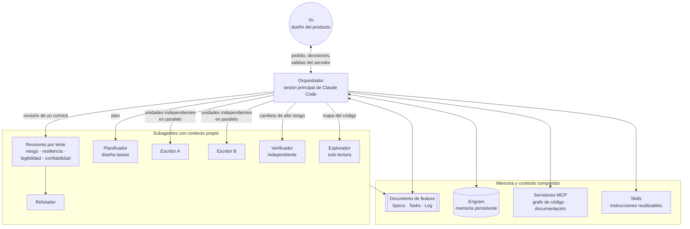
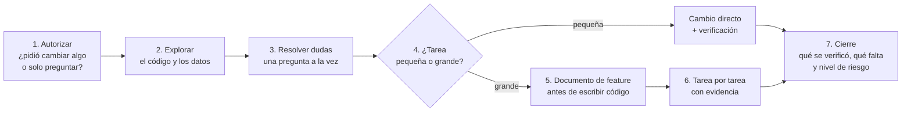
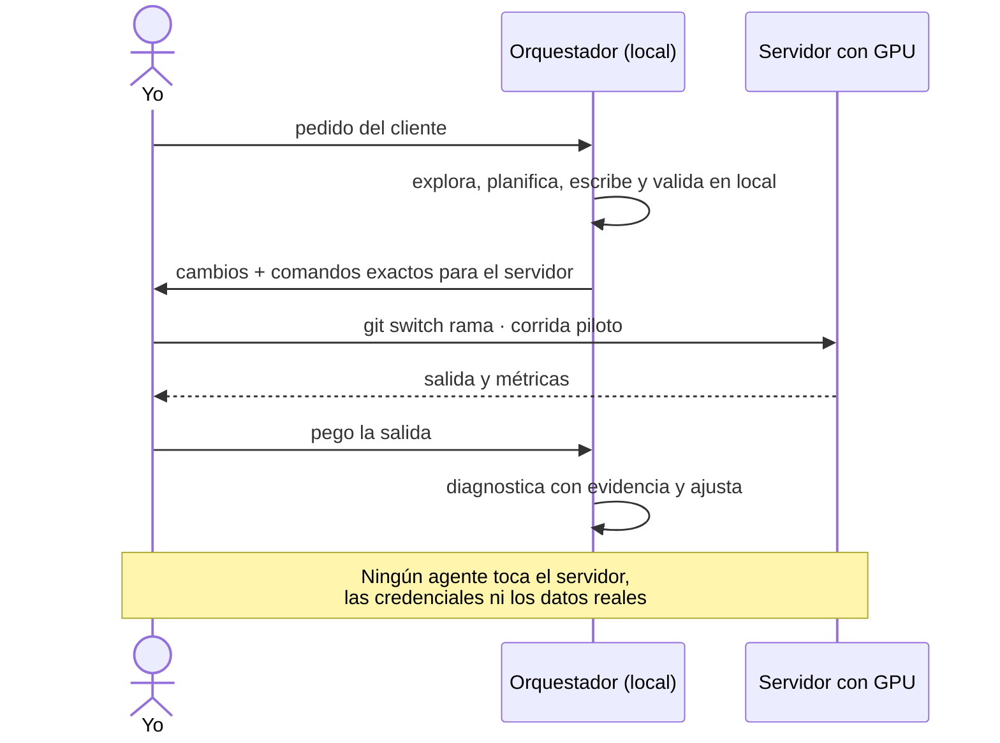

# 4. Desarrollo con sistemas multiagente

**El sistema lo construí dirigiendo un equipo de agentes de IA**: una sesión orquestadora que planifica y coordina, subagentes con roles acotados (explorar, planificar, escribir, verificar, revisar) y una memoria persistente compartida entre sesiones. Yo defino el alcance, tomo las decisiones de producto y valido cada resultado. Los agentes ejecutan bajo esas reglas.

## La topología



| Rol | Cuándo entra | Qué recibe | Qué devuelve |
|---|---|---|---|
| **Orquestador** | Siempre | Mi pedido literal | Plan, coordinación y síntesis corta |
| **Explorador** | Cuando entender el código requiere más de unas pocas lecturas | Una pregunta acotada | Mapa con rutas y líneas, sin volcar archivos completos |
| **Planificador** | Features grandes | El documento de la feature | Tareas con criterios de aceptación |
| **Escritores** | Dos o más unidades independientes con archivos disjuntos | Tarea, specs y superficie de edición permitida | Cambio + verificaciones ejecutadas |
| **Verificador** | Solo si el cambio toca algo de alto riesgo (datos, seguridad, contratos, concurrencia, despliegue) | Documento completo y comandos de prueba | Veredicto por cada spec |
| **Revisores + refutador** | Revisión de un commit candidato | El diff congelado | Hallazgos. El refutador intenta tumbarlos antes de que bloqueen |

### Por qué subagentes y no una sola sesión

- **Contexto limpio.** Cada subagente lee lo que necesita y devuelve un resumen. La sesión principal no se llena de archivos y conserva el hilo de la conversación.
- **Paralelismo real.** En una feature, el informe y un experimento aparte los escribieron dos agentes a la vez, porque no compartían archivos.
- **Independencia.** Un verificador que no escribió el código no hereda sus supuestos.

## El protocolo de trabajo: ODD

Usé un flujo llamado **ODD (Organic Driven Development)**. Todo pedido pasa por los mismos pasos, y el tamaño de la tarea decide cuánta ceremonia lleva:



### El documento de feature es el contrato

Cuando la tarea es grande, antes de tocar código se crea un documento que **todos los agentes leen**:

```markdown
# Rediseño de la operación X (voz + WhatsApp)

## Specs
- S1 Fuentes. Usuario: "<cita literal del pedido>"
- S2 Periodo. Usuario: "<cita literal>"
- S5 Matriz. P1 … P8 con criterio y peso (citados del formato de solicitud)

## Tasks
| ID | Specs | Ruta      | Estado | Evidencia                         |
| T2 | S1,S2 | inline    | hecho  | compilación OK; corrida en seco OK |
| T4 | S3,S6 | delegada  | hecho  | ejecutada en paralelo con T5       |

## Log
- L1 pedido original, literal
- L7 salida del servidor: el canal de chat usa otra campaña → se ajusta S1
```

Reglas que hacen que funcione:

- **Las specs citan mis palabras literales**, sin resumirlas. Así, al resumir o al cambiar de sesión, no se pierden requisitos.
- **Cada tarea declara su ruta** (directa o delegada) y su evidencia. Si se salta una delegación, queda a la vista.
- **Nada se marca como hecho sin una prueba observada.** Las verificaciones fallidas o pendientes se registran tal cual.
- **Un cambio de requisito** agrega una entrada al log, reescribe solo la spec afectada y reabre solo su tarea.

## Memoria persistente

Las sesiones de IA olvidan todo al cerrarse. Usé **Engram**, un servidor MCP de memoria, para que el conocimiento sobreviva:

| Se guarda | Ejemplo |
|---|---|
| Decisiones | "El modelo local se queda en X porque el mejor no cabe en la VRAM con concurrencia 2" |
| Bugs y su causa | "Sin `ORDER BY`, los mensajes de chat se desordenaban y cambiaba la huella" |
| Convenciones | "Tres archivos por operación; los artefactos van en `resultados/`" |
| Restricciones del entorno | "La GPU tiene 16 GB; ninguna configuración puede pasar del 90 %" |
| Copia del documento de feature | Para retomar una tarea interrumpida en otra sesión |

Al empezar una sesión, el orquestador recupera el contexto del proyecto antes de proponer nada.

## Herramientas del ecosistema

| Herramienta | Uso |
|---|---|
| **Claude Code** | Orquestador y subagentes |
| **MCP: grafo de código** | Índice de símbolos y llamadas del repositorio. Una consulta devuelve el código relevante y su radio de impacto, sin leer archivo por archivo |
| **MCP: documentación de librerías** | Documentación actual de pandas, LangChain, Ollama y otras, en lugar de lo que el modelo recuerda |
| **MCP: Engram** | Memoria persistente por proyecto |
| **Skills** | Instrucciones reutilizables, como diseño de documentación, commits por unidades de trabajo o revisión adversarial con dos jueces a ciegas |

## Humano en el circuito

El pipeline corre en un servidor con GPU al que los agentes **no tienen acceso**. Esa frontera fue deliberada:



- **Medir, no inferir.** Si el agente no puede comprobar algo, lo marca como hipótesis y entrega un script para medirlo en el servidor.
- **Separar errores preexistentes de errores propios**, con `git diff` como prueba.
- **Las decisiones de producto son mías.** Cuando hay una decisión abierta, el agente hace una sola pregunta y espera.

## El mismo patrón dentro del producto

Lo que funcionó para desarrollar también se aplicó al sistema: **un modelo genera y otro juzga a ciegas**. Claude evaluó muestras etiquetadas sin ver las predicciones de los modelos locales ni de un clasificador especializado, y con eso se eligió el modelo de producción (ver [capítulo 3](03-ia-en-el-pipeline.md#comparación-de-modelos-y-llm-como-juez)). El ejemplo lo reproduce con datos sintéticos en [`multiagente.py`](../ejemplo/multiagente.py): evaluador, juez a ciegas, verificador de citas y kappa de Cohen.

## Siguiente

[5. Despliegue y operación →](05-despliegue-y-operacion.md)
