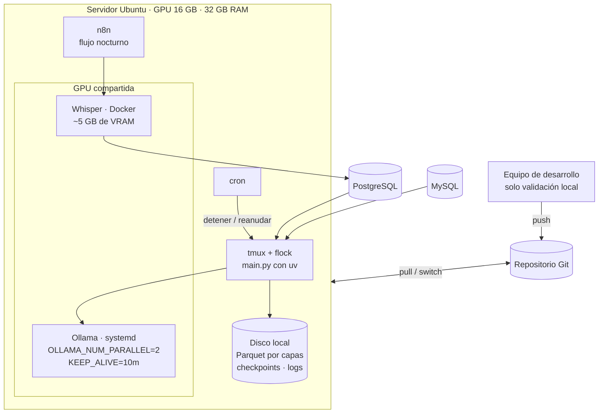
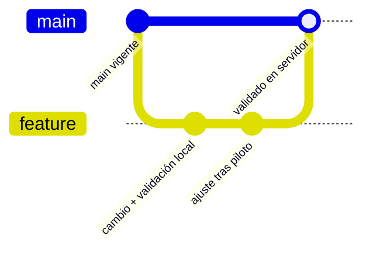

# 5. Despliegue y operación

**Todo corre en un servidor Ubuntu propio con una GPU de 16 GB, compartida entre la transcripción nocturna (Whisper) y el análisis con LLM (Ollama).** El reparto de la GPU, las ventanas de cron y los checkpoints permiten que los dos convivan sin pisarse.

## Infraestructura

## Presupuesto de VRAM

La regla del servidor: **ninguna configuración puede superar el 90 % de la VRAM**, porque Whisper necesita su espacio cada noche.

| Configuración | VRAM aproximada | ¿Convive con Whisper? |
|---|---|---|
| Modelo de ~8B, contexto de 12k tokens, 2 en paralelo | ~9 GB | Sí |
| El mismo, con contexto de 16k | ~10 GB | Sí |
| Contexto de 32k (solo para repasar filas largas) | Alta | Solo sin Whisper activo |
| Modelo de ~14B con 2 en paralelo | Por encima del límite | No. Se descartó aunque era más preciso |

### Concurrencia medida, no supuesta

Antes de fijar la concurrencia se midió en el servidor con un benchmark propio:

| Concurrencia | Segundos por fila | Aceleración |
|---|---|---|
| 1 | ~14 | 1,0× |
| 2 | ~8 | ~1,8× (89 % del ideal) |
| 3 | — | No cabe con Whisper |

El tamaño de lote solo agrupa filas en Python y no afecta la VRAM. La ventana de contexto sí: se paga en memoria, no en velocidad.

## La jornada del servidor

```mermaid
gantt
    title Uso de la GPU en 24 horas
    dateFormat HH:mm
    axisFormat %H:%M
    section LLM
    Análisis con Ollama      :a1, 06:00, 18h
    section Corte
    cron detiene main.py     :milestone, 00:30, 0m
    section Whisper
    Transcripción nocturna   :w1, 00:30, 5h30m
    section Reanudación
    cron reanuda main.py     :milestone, 06:00, 0m
```

- **Detener** envía una señal limpia. El bucle guarda el checkpoint en su bloque `finally` antes de salir.
- **Reanudar** lanza `main.py` en una sesión de `tmux` con `flock`. Si ya hay una corrida activa, no lanza otra. Las operaciones terminadas se saltan y la interrumpida sigue desde su último checkpoint.
- Las operaciones se ejecutan **de la más corta a la más larga**. La primera funciona como canario: si falla, el problema aparece en minutos y no en horas.
- Siempre se usa `python -u` para que el log escrito con `tee` no quede en el búfer y la corrida no parezca colgada.

## Flujo de despliegue

1. Cada cambio va en una rama creada desde `main`.
2. En local solo se valida: compilación, `import main`, búsqueda de referencias rotas y pruebas con DataFrames fabricados a mano.
3. En el servidor se hace `git switch` a la rama y se corre un **piloto de ~100 filas** (unos minutos) antes de gastar horas de GPU.
4. Si el piloto es correcto, la rama se une a `main` y el servidor vuelve a `main`, porque cron ejecuta lo que esté en la rama activa.
5. En git solo se versionan los entregables finales. Los Parquet intermedios, checkpoints y logs se quedan en el disco del servidor.

## Entorno y dependencias

- `uv` con `pyproject.toml` y `uv.lock` para que las instalaciones sean reproducibles.
- Para experimentos con dependencias pesadas (por ejemplo, otro framework de ML) se usa `uv run --with <paquete>`, sin contaminar el entorno de producción.
- Las credenciales van en `.env` fuera de git. Las conexiones a bases de datos se crean de forma **perezosa**, con `pool_pre_ping` y reciclaje de conexiones.

## Flujo de contingencia

Si la transcripción nocturna no procesó un periodo, un script descarga los audios pendientes, los envía al servicio de transcripción, descarta los que ya estaban transcritos y registra los metadatos. Después, el pipeline sigue normal desde la etapa 1.

## Observabilidad

| Señal | Herramienta |
|---|---|
| Avance por operación | Barras de progreso y log por corrida, con fecha en el nombre |
| GPU, RAM y temperatura | Script de monitoreo de recursos que escribe telemetría en CSV |
| Calidad de cada corrida | Resumen de diagnóstico: filas con contexto insuficiente, JSON rescatado y errores reales |
| Congelamientos del sistema | Journal persistente de `systemd` para diagnosticar después del reinicio |

## Siguiente

[6. Lecciones aprendidas →](06-lecciones-aprendidas.md)
